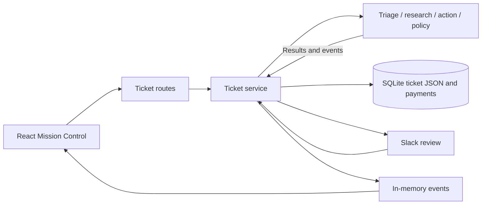
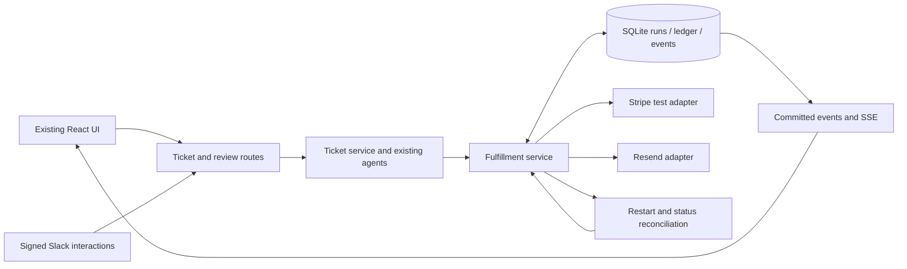
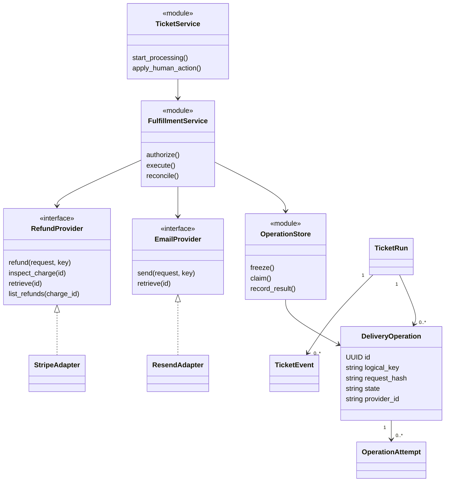
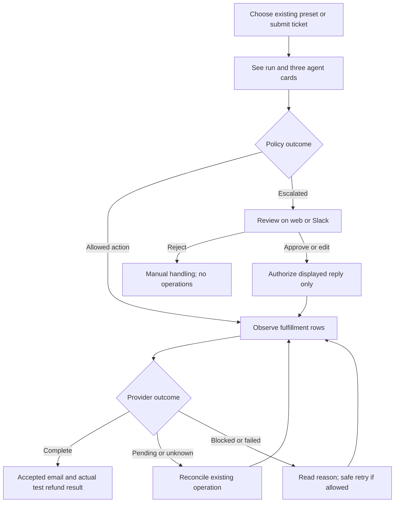
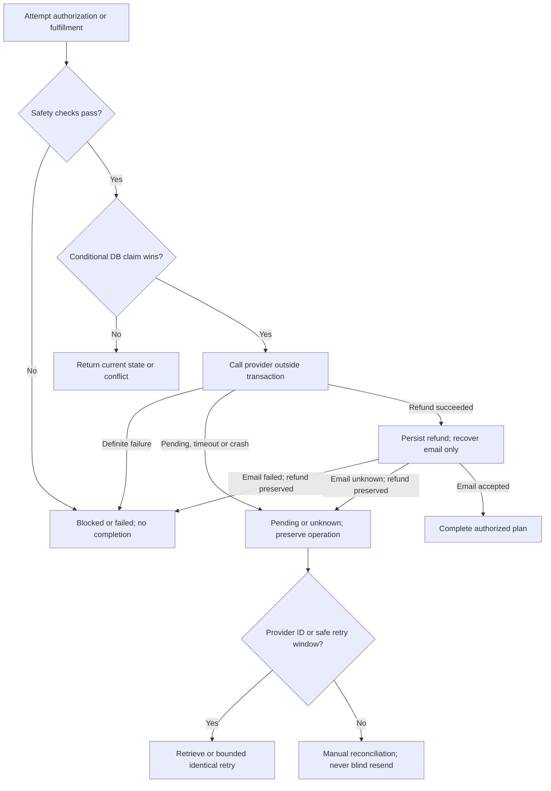

# Relayy: safe provider-backed hackathon delivery

## Approach

Extend the existing FastAPI, SQLite and React application rather than replace its agent workflow. Keep triage → customer-scoped research → action → Python policy, the four demo presets, Mission Control, Impact metrics, and web/Slack review. Add one small fulfillment service behind narrow Resend and Stripe adapters. All automated and approved actions use that service and the same durable operation records.

This is a **single-process hackathon demonstration**, not a production support platform. Resend sends real messages only to explicitly approved test inboxes. Stripe refunds use real API calls against test-mode charges only. USD full-payment refunds up to $50 remain the only automatic money action. Do not introduce live payments, arbitrary partial refunds, multi-tenant authentication, a general workflow engine, or distributed workers.

Documentation precedes product changes. The baseline is the complete repository `README.md` plus inspected source on `vorflux/delivery-analysis`; existing claims are not proof of external delivery. Companion audit documents hold detailed requirement-to-source traceability. This plan defines the component contracts and acceptance gates needed for building. Static inspection was performed; no application runtime or provider success is claimed.

## Design and important details

### Verified existing architecture and gaps

- `backend/swarm/{triage,research,action,policy,tools,security}.py` already implements the three agents, scoped read-only tools, manipulation checks and policy overrides. Preserve the rules for suspicious input, critical urgency, angry VIPs, confidence below 0.75 and refunds over $50.
- `backend/ticket_service.py` currently saves replies locally and changes the first same-amount successful payment to refunded. There are no Resend/Stripe calls, provider charge IDs, currency fields or durable delivery records. `Payment.amount` is a float.
- `apply_human_action` is shared by web and Slack, but its read-then-write review check can race. It currently declares success before any external operation. A forced escalation drops executable refund amount while retaining the original proposal; that original proposal must never become implicit refund authorization.
- Reprocessing clears current state and outcomes; restart recovery resets processing tickets to open. Events live in memory until state persistence, and ticket SSE IDs are list indexes that restart per run. Global SSE does not replay missed changes.
- React already has desktop/phone navigation, editable review, four fictional-customer presets and metrics. Outcome and Slack wording currently overstate “sent” and “refunded”; failed run requests are not surfaced consistently.
- `backend/swarm/test_triage.py` is a sample smoke script, not a comprehensive deterministic suite. The frontend has build/lint scripts but no test script. Missing credentials and invalid model access can enter simulated agent paths, so sample output alone cannot prove model execution.
- README model IDs `claude-haiku-5-5` and `claude-sonnet-5-5`, the fallback beta in `swarm/llm.py`, and its pricing are **unverified configuration**, not validated provider capabilities. Do not invent replacement IDs or prices.

Existing high-level flow (local outcomes only):



Proposed high-level flow (new fulfillment boundary):



### Safety and scope decisions

**Payment identity and money.** Add an explicit `payment_id` and integer `refund_amount_minor` to `ActionProposal` and `ActionResult`, and expose integer amount/currency in `PaymentRecord`. The model chooses only a local payment ID returned by that ticket's scoped research. Provider identifiers come from trusted stored bindings, never ticket text or model output. Legacy float fields can remain read-only compatibility/display fields during migration; no provider request or safety comparison uses float arithmetic.

Before authorizing and again before executing a refund, require all of the following:

- Ticket customer owns the selected local payment and its verified Stripe customer binding. The payment appeared in the ticket's research. Missing scope fails closed.
- Stripe account equals the configured demo account; the retrieved Charge belongs to the bound Stripe customer, has `livemode=false`, is paid/captured, and has the expected currency and original captured amount.
- Currency is `usd`; amount is a positive integer, equals the full original captured payment, and is at most 5,000 cents. Reject fractional cents, NaN/infinity, zero/negative values, currency mismatch and malformed or missing IDs.
- No partial, pending, completed or unknown refund already reserves this charge. Retrieve current charge/refund information, not merely local `Payment.status`. A unique refund target in the ledger prevents two tickets spending the same payment.
- Successful refund total never exceeds the captured amount; the requested amount never exceeds the provider's remaining refundable balance. This demo rejects partially refunded charges instead of introducing new partial-refund rules.
- Refunds always go through Stripe's original-charge refund path, never a requested bank account/card. Do not accept destination overrides, Connect account routing or transfer reversal parameters.

Preserve existing policy IDs where their meaning still applies, and add specific machine-readable reasons for missing/ambiguous identity, unsupported currency, unverified provider binding, unavailable providers and conflicting operations. An amount-only match is not authorization, even when only one current row matches. Deterministic simulated proposals also select an exact payment ID.

**Human authorization.** Record separately the model's proposal, the policy-approved action, the human decision and provider results. Approve/Edit on an escalated ticket authorizes only the displayed reply (normally a holding reply); Reject creates no provider operation. Never inspect `action.proposal.refund_amount` to recover a refused refund. A $450 request stays a no-refund holding-reply approval. A new explicit human refund-override feature is outside this scope. Blank/whitespace drafts are rejected consistently in web and Slack, and approval cannot silently change the frozen recipient, payment or amount.

**Demo delivery boundaries.** Default external delivery to disabled. Enabling `DELIVERY_MODE=test` requires an approved server-side recipient mapping, a permitted sender and a verified test account/charge mapping. Never use seeded `Customer.email` as a delivery fallback. Preserve the four fictional scenarios and their visible identity; show “test delivery to …” separately when an operator has explicitly mapped a scenario to an approved inbox. All other recipients, CC/BCC, model-provided addresses and live-mode Stripe objects are blocked before writes. Validate the recipient configuration before issuing a refund, so known email setup problems cannot create an avoidable partial outcome.

Simulation is for analysis demonstration only and has **no automatic provider authority**, even when heuristics report high confidence. Record per-stage `source=real_model|simulated|failed` plus errors; missing credentials, broad-exception fallbacks, refusal or incomplete research block all automatic external actions. A human may explicitly approve/edit a safe displayed reply, but that authorizes email only and never a simulated refund. Real automatic fulfillment requires successful, provenance-verified model stages plus deterministic policy checks. Record the model actually used and whether its price is verified. Unknown pricing produces an unavailable estimate, not a fabricated zero-cost result.

**Deterministic refund eligibility.** Match the seeded help-document rules in addition to the $50 automation ceiling. Server-managed fixture metadata records purchase type (`monthly`, `annual`, `addon`, `upgrade`, `enterprise`), authoritative charge time, workspace/billing period, eligibility reason, evidence/verification time, and any confirmed duplicate peer payment ID. Ordinary monthly purchases are non-refundable; annual renewals/initial charges and accidental add-ons/upgrades require a request within 14 days, using ticket receipt time rather than delayed execution time. Enterprise always escalates. A documented duplicate exception requires two settled owned charges for the same workspace/period/product, identifies the newer charge, and permits full refund irrespective of age only when the other safety rules and $50 cap pass. Equal amounts or free-text descriptions alone do not prove a duplicate. Missing, stale, conflicting or unverified eligibility metadata escalates; the model cannot set it. The approved $30 add-on fixture explicitly supplies this evidence.

Apply the existing selected card/phone redaction through one shared model-boundary helper in `swarm/llm.py`/`security.py` for every triage, research and action prompt, including model-bound tool text. Preserve raw input only in the controlled local audit record, not provider prompts or logs. Run manipulation detection independently. This is selected-pattern sanitization, not a claim of complete PII removal; only synthetic/approved demo data belongs in this application.

### Persisted records and constraints

Keep `backend/models.py` as the SQLModel source of truth. Introduce focused records rather than a general event-sourcing framework:

| Record | Important fields and constraints |
| --- | --- |
| `Customer` additions | Nullable `stripe_customer_id`, `provider_account_id`, binding verification timestamp. Explicit `demo_recipient` mapping is server-managed and checked against the configured allowlist. Existing fictional email remains identification only. |
| `Payment` additions | Nullable `provider_account_id`, `stripe_charge_id`, `amount_minor`, `currency`, `livemode`, `binding_verified_at`, structured `eligibility_evidence` JSON; unique non-null `(provider_account_id, stripe_charge_id)`. Eligibility contains purchase type, charge time, workspace/billing period, reason, duplicate peer ID and verification evidence. Legacy rows remain unverified and ineligible until deliberately bound. These fields are managed only by fixture setup, never seed inference or merge. |
| `Ticket` additions | `current_run_id`, monotonically increasing `version`; retain existing fields as current-state compatibility projections, not proof of delivery. |
| `TicketRun` | UUID, ticket FK, run number, lifecycle state, immutable input snapshot, persisted agent state/usage, execution mode, start/end time, review revision, review outcome/channel/actor/time, frozen authorized plan JSON. Unique `(ticket_id, run_number)`. Superseded/interrupted runs remain readable. |
| `DeliveryOperation` | UUID, ticket/run FK, kind `email` or `refund`, provider/account, unique logical key, frozen request JSON + hash, stable provider idempotency key, dependency operation ID, state, raw provider status, provider object ID, first-attempt time, retry deadline, attempt count, claim token/version/expiry, next check time, sanitized error code/message, created/updated times. |
| `OperationAttempt` | Append-only operation FK, attempt number, claim token, send/reconcile kind, start/end time, request hash, safe response classification, provider request/object IDs and error. No credentials or full raw provider responses. |
| `TicketEvent` | Persistent increasing integer ID, ticket/run FK, kind, timestamp and JSON data. Unique ID never restarts per run; include run ID in every payload. Persist before publishing. |

Use `email:ticket:<id>` as the single outbound reply logical key in this bounded demo. Reruns cannot create a second reply; follow-up email workflows are out of scope. Use `refund:<account>:<charge>` as the unique refund logical key across tickets and runs. This is intentionally stricter than supporting repeated partial refunds. A failed or unknown operation does not release that key or authorize a new financial intent.

Provide an explicit versioned, transactional SQLite migration in `backend/db.py` and a small `backend/migrations/` module. The existing nullable-column adder cannot establish required unique indexes, backfill provenance or preserve historical semantics by itself. Do not infer Stripe bindings from amount or automatically convert historical “resolved/refunded” rows into provider success. Mark them legacy local-only; retain their original audit data. Check migration constraints on a copy of an existing demo database as well as a fresh database.

`backend/seed.py` must refuse overwriting provider-bound rows or wiping a database that has external-operation audit records. Keep ordinary fictional seeding idempotent on an untouched offline demo database. Provider demonstration setup uses a separate explicit configuration/binding command (`backend/demo_setup.py`) to bind test charges to scenario payments after ownership/mode/amount validation. Resetting a fictional database must never erase the only record of a possibly executed provider operation.

### Small component boundaries

- `backend/fulfillment/contracts.py`: typed immutable `EmailRequest`, `RefundRequest` and normalized provider results; `EmailProvider` Protocol with `send(request, key)` and `retrieve(id)`; `RefundProvider` Protocol with `refund(request, key)`, `retrieve(id)`, `inspect_charge(id)` and `list_refunds(charge_id)`. Results distinguish definite refusal from unknown execution. No model concerns here.
- `backend/integrations/resend.py` and `backend/integrations/stripe.py`: implement those Protocols with the existing async HTTP client dependency, explicit timeouts and bounded responses. No implicit SDK POST retries. Pass frozen payloads and idempotency keys unchanged, retain provider request IDs, classify 429/5xx/timeouts conservatively and redact errors. Pin and validate any chosen Stripe API version against fixtures and current docs.
- `backend/fulfillment/service.py`: the one place that validates authorization, freezes operations, claims work, calls adapters, reconciles state and derives ticket completion. A small `store.py` holds conditional updates/transactions so policy, routes and adapters do not duplicate persistence logic.
- `backend/ticket_service.py`: retain agent orchestration and review entry points; replace `_reconcile_refund` and “reply sent” shortcuts with calls to fulfillment. Persist run snapshots/events throughout execution. Reuse one ticket serializer for create/read/review/status responses.
- `backend/swarm/{state,triage,research,action,policy,tools,llm}.py`: carry exact payment identity, money, eligibility and per-stage provenance end to end; eliminate high-confidence fallback authority; make `ToolContext.check_customer` reject missing scope as well as a different customer. Keep provider calls outside AI tools and use shared selected-pattern sanitization at every model boundary. `security.py` remains independent of model output.
- `backend/routers/{tickets,slack}.py` and `backend/integrations/slack.py`: validate the current run/review revision, persist authorization promptly and return without waiting for provider calls. Slack keeps signature/timestamp verification and acknowledges within its deadline; store a safe channel/message target for later truthful status refresh. No provider network call occurs inside a database transaction.
- `backend/main.py`: start one bounded recovery/fulfillment loop in the existing lifespan and stop it cleanly. A DB row is the durable work queue; background-task scheduling is only a wake-up hint. Health reports configured/blocked states without secrets and without claiming successful provider access from key presence alone.

Proposed logical low-level relationships (class-diagram notation): `TicketService`, `FulfillmentService` and `OperationStore` represent function modules, not proposed wrapper classes. `EmailProvider` and `RefundProvider` are Python Protocols; adapters are their concrete implementations, and persisted records are SQLModel classes. Keep the existing functional style without adding service-class wrappers solely to match this diagram.



### Operation lifecycle, concurrency and recovery

States are `blocked`, `queued`, `executing`, `unknown`, `pending`, `accepted`, `succeeded`, `failed`, and `canceled`. `accepted` is the terminal submission result for email; `succeeded` is a verified Stripe refund result. Preserve raw provider status and observation time separately. Resend acceptance does **not** prove inbox delivery or that a user read the mail. Stripe `pending`/`requires_action` is not success; failed/canceled refunds never count as refunded. An unfamiliar provider status remains non-success and requires reconciliation.

A short database transaction conditionally changes the expected ticket/run version from reviewable to authorized, freezes the payload, inserts unique operations and records the audit event. Check affected-row counts; only one web/Slack reviewer wins. Stale edits or clicks receive a conflict and current state. Repeated authorization returns the existing operation; it cannot generate a new key. Reject racing with Approve also has a single winner. Network requests happen only after commit.

A worker claims an eligible operation using a conditional update on its state/version and stores an attempt/claim token. Commit that claim before sending. Persist the result using the same token/version and derive ticket state atomically with it. An expired executing claim becomes **unknown**, not automatically queued: a stalled first sender may already have reached the provider. Recovery reconciles before any possible retry. In-memory locks can reduce duplicate work but never provide the safety guarantee.

- Freeze `from`, approved `to`, subject, text, payment target, currency, amount, provider account and metadata at authorization. Send only one text email recipient; no CC/BCC. A request hash mismatch blocks execution. An edited reply cannot mutate an attempted request under the same idempotency key.
- Generate a provider idempotency key once from the persisted operation UUID, never from a run number, timestamp, retry count or only an amount. Include the operation UUID as Stripe refund metadata for recovery. Keep payloads and keys out of client control.
- Persist `first_attempt_at` **before** the first POST. Use a conservative automatic retry cutoff of 23 hours from that timestamp, leaving margin below the documented 24-hour key retention. Limit send attempts and use bounded backoff/Retry-After; never let an unbounded retry loop outlive the cutoff. Both provider contracts have finite idempotency retention; this is duplicate resistance, **not exactly-once delivery**.
- For Resend unknown sends without an email ID, retry only the identical request/key within that safe window. Once it expires, never blind-send again, rotate the key, or infer non-delivery from absence of a local ID. Keep the operation unknown/manual-reconciliation required. If an ID exists, retrieve it without resending. Operator evidence can associate a confirmed provider ID, but this scope does not add a force-send bypass.
- For Stripe, retrieve a known refund ID. Without one, inspect the exact charge and paginate its refunds, matching operation metadata plus amount/currency/account. A positive match reconciles the original operation. No match after ambiguous execution is not sufficient proof to create a new refund after the key window; leave it blocked for operator investigation. Do not launch an alternate charge or refund intent.
- On restart, preserve all successful/accepted operations and attempts. Mark interrupted agent runs interrupted; do not resume an old model output as fresh authorization. Resume eligible queued work and reconcile pending/unknown provider operations using bounded scheduled checks. Persistent failures remain visible rather than continually retrying.
- A refund-dependent email stays queued and unclaimable until the linked refund is verified succeeded. A pending/failed/unknown refund cannot send the draft claiming success. Validate or normalize refund confirmations to the actual observed result; do not promise a bank posting deadline that has not been verified.
- If the refund succeeded and email failed or became unknown, show partial success and retry/reconcile **only email**. Never re-run the refund as compensation. If refund status later changes to failure on retrieval, retain the success observation and any accepted email in history, reopen the ticket for manual attention, and correct current UI/metrics without sending an unrequested second message.

For email-only auto-resolve, completion means accepted by Resend. For auto-refund, completion requires refund succeeded **and** dependent email accepted. Use existing `pending` while fulfillment is active; use `escalated` for blocked/manual attention but distinguish operational attention from an unconsumed review. Set `final_reply` and final resolution only from actual accepted email, never a draft. An approved holding reply may complete the authorized communication but the UI must say “holding reply accepted; no refund authorized” and flag that the original issue needs follow-up. Approval is not proof that the customer received the email or the original refund request was fulfilled.

Happy sequence for an authorized test refund:

```mermaid
sequenceDiagram
  participant U as Operator
  participant T as Ticket service
  participant D as SQLite ledger
  participant F as Fulfillment
  participant S as Stripe test
  participant R as Resend
  U->>T: Submit approved demo scenario
  T->>T: Triage, scoped research, action, policy
  T->>D: Freeze exact refund + dependent email
  F->>D: Conditional refund claim and attempt
  F->>S: Verify charge; refund with stable key
  S-->>F: Refund ID, succeeded
  F->>D: Persist success; release email dependency
  F->>D: Conditional email claim and attempt
  F->>R: Frozen approved-recipient email + stable key
  R-->>F: Email ID, accepted
  F->>D: Persist acceptance and completion event
  D-->>U: SSE/GET: test refund succeeded; email accepted
```

### API and event contracts

Retain existing ticket URLs and existing detail fields, adding these explicit projections in `backend/routers/tickets.py` and `frontend/src/api.ts`:

- `TicketDetail`: `run_id`, `version`, `execution_mode`, `fulfillment_state`, `manual_followup_required`, `can_review`, `can_reprocess`, `operations[]`. Each operation exposes `{id, kind, state, provider_status, provider_id, amount_minor, currency, test_mode, recipient, updated_at, error_code, error_message, allowed_actions}`; omit frozen payloads, keys and secrets. The frontend never derives allowed retries from status strings alone.
- `TicketSummary`: `run_id`, `fulfillment_state`, concise email/refund status and `legacy_local_only`. Preserve proposal `decision` separately from actual `resolution`. Intake strips required text, rejects whitespace-only subject/body and conflicting customer ID/email instead of silently choosing one identity.
- `POST /tickets/{id}/review`: `{action: approved|edited|rejected, reply?, reviewer, run_id, expected_version}`. Existing clients are updated together; missing/stale revision is rejected. Approve ignores an arbitrary client reply and uses the persisted draft; Edit requires nonempty bounded text. Return `202` with current detail after durable acceptance, not external completion. Slack carries the same run/revision in button values and modal metadata.
- `POST /tickets/{id}/operations/{operation_id}/retry`: `{expected_version}`. Only the server's safe same-operation retry policy can accept it; return `202`, or `409` with a reason and fresh state. It cannot edit payloads or reset retention clocks.
- `POST /tickets/{id}/operations/{operation_id}/reconcile`: `{expected_version}`. Schedules read-only provider reconciliation, or the already-defined safe same-key recovery within the retry window when no provider ID exists; no new logical intent. Return `202`.
- `POST /tickets/{id}/process`: allow a new analysis run only when no fulfillment operation or active review claim exists; otherwise `409` directs the caller to retry/reconcile the existing operation. Before side effects, rerunning a reviewable ticket supersedes its prior run and invalidates stale Slack/web revisions. After any delivery operation exists, new side-effectful reruns are deliberately unavailable in this demo; use a fresh scenario ticket and independently provisioned test payment where needed.
- `GET /tickets/{id}/runs`: return archived run summaries/state for audit, including legacy local-only provenance. Current agent cards show only the selected/current run; prior runs remain inspectable.

`backend/events.py` and the stream route publish persisted `TicketEvent.id`, not an index into `state.events`. Synchronous DB work may run in a thread, but publication must return to the owning event loop (or use `loop.call_soon_threadsafe`); never call `asyncio.Queue.put_nowait` from the sync review worker thread. Bound subscriber queues; overflow closes/invalidates the stream so the client reconnects and replays rather than growing memory indefinitely. SSE carries `{ticket_id, run_id, version, ...}`. Replay by the durable cursor, subscribe before taking the replay watermark, and deduplicate the overlap by event ID. Status snapshots include the authoritative current run/version. Bad or obsolete cursors cause a snapshot/reset response rather than silently dropping a new run's events. Old events cannot overwrite newer snapshots.

`useTicketStream.ts` hydrates events and structured results from the authoritative detail snapshot, so completed cards never depend on receiving every SSE event. It reconciles on every connection/reconnection, scopes agent events by run, clears stale errors after successful fetches, ignores older request responses/versions, validates event parsing and shows a recoverable connection warning. `useLiveUpdates.ts` refetches inbox/metrics on reconnect because the global bus remains an advisory invalidation channel. Delivery state is always recoverable from GET even if every live event is missed.

### UI, review and metrics

Use the Design-tab manifest supplied with the approval plan, its six `delivery-{accepted,unknown,failed}-{desktop,phone}-dark.html` delivery artifacts, and the design subagent’s desktop/phone operator-unlock artifacts for the small Outcome/review and protected-mutation controls; do not redesign Mission Control or replace its responsive layout. The accepted state shows test refund succeeded plus email accepted (not delivered); the unknown state blocks duplicate actions; the failed state preserves successful refund and offers server-authorized email-only recovery. Extract a small fulfillment Outcome component and, where it reduces duplication, the existing review card; do not introduce a new UI framework or configuration screen. Preserve all four preset names/scenarios and make their configured test-delivery readiness explicit. Presets with missing bindings still demonstrate analysis/review but show blocked delivery, not pretend provider success.

Update `frontend/src/components/TicketView.tsx`, `Inbox.tsx`, `NewTicketForm.tsx`, `MetricsDashboard.tsx`, `frontend/src/lib/format.ts`, `frontend/src/App.tsx` and the stream hooks only where their contracts require it. Keep status formatting in one shared helper rather than duplicate labels across screens.

- Show separate Refund and Email rows: “Stripe test refund succeeded”, “Refund pending/unknown”, “Email accepted by Resend — inbox delivery not confirmed”, and actionable blocked/error reasons. Show no-refund explicitly for a holding reply.
- Disable duplicate Approve/Send and re-run while operations exist. Show only server-allowed Retry or Reconcile controls. Surface API errors for process/review/recovery, including validation details, without relying solely on SSE to update the view after a successful action.
- Stale review conflicts refresh detail and preserve the explanation. Avoid an empty approval on a failed pipeline with no draft. Keep the keyboard-accessible editing and responsive phone workflow.
- Slack notes first say authorization queued, then reflect provider outcome. Finalize and commit the reviewable run before exposing its buttons; `_live` cleanup is not authorization state. A fast click that loses a transient claim must not strip still-valid review buttons; return an ephemeral conflict and refresh authoritative state instead. A Slack update failure cannot roll back a successful refund/email or cause a resend. Stale buttons remain harmless because the server validates the revision.
- `ticket_service.metrics()` counts verified succeeded refund operations, not proposed amounts. Keep decision/escalation counts separate from completion, label test refunds as sandbox money and exclude legacy local-only records from provider totals. Preserve estimated time saved as an explicit estimate; show model cost unavailable when pricing is not validated. Read all run usage for incurred-cost totals without counting repeated runs as new tickets or duplicated financial results.

User journey:



Edge handling:



### Provider setup, explicit execution blockers and demo boundary

No working credentials or valid provider payment bindings have been established by this investigation. External execution remains **blocked** until these are securely provisioned and checked. Missing keys do not block implementing and testing adapter contracts with fakes; fake success must never be reported as real-provider acceptance.

- `RESEND_API_KEY`: a dedicated demo-account key capable of sending and retrieving sent emails. Resend's sending-only permission cannot support retrieval; use the documented full-access key in a dedicated demo account for this scope. Set `RESEND_FROM` to a provider-permitted sender (verified domain or the provider's restricted test sender). Confirm the permitted recipient for any restricted sender and explicitly approve the inbox allowlist/mapping. Obtain/manage these at https://resend.com/api-keys and https://resend.com/domains.
- `STRIPE_SECRET_KEY`: test/sandbox secret or restricted test key with charge/customer/refund read access and refund write access in the intended account. Configure expected account identity and reject live credentials; key prefix checks supplement, not replace, object `livemode=false` checks. Obtain test keys and inspect charges at https://dashboard.stripe.com/test/apikeys and https://dashboard.stripe.com/test/payments. Provide genuine test charges and verified ownership mappings; fictional seed payments are not refundable provider transactions.
- `ANTHROPIC_API_KEY`: needed only for a claimed real-model demonstration. Validate configured model access, structured-output/fallback parameters and current pricing before labeling model runs/costs real. Keep model IDs configurable and expose validation failures; explicit simulated mode remains available.
- Existing Slack bot/signing/channel configuration is needed for an end-to-end Slack demonstration; without it, web review works and Slack is reported unverified. Use `chat:write`, a channel the bot can access, a valid signing secret and a reachable Slack interaction endpoint. Secrets are requested through secure setup by the main agent, never pasted into documentation or chat.

Record safe preflight results by category: missing setting, invalid credential, permission denied, sender/recipient disallowed, live-mode mismatch, unknown charge, ownership/money mismatch, model unavailable or provider unreachable. Key presence alone is not a pass. Provider tests must not fall back to simulation when these checks fail.

The current web API has no user authentication; reviewer names are labels, not verified identities. Add a narrow server dependency in `backend/demo_auth.py` requiring `Authorization: Bearer <DEMO_OPERATOR_TOKEN>` for every web mutation, including ticket creation/process (which can trigger automatic effects), review, retry and reconciliation. Compare against a securely configured high-entropy token in constant time; missing configuration fails closed when delivery is enabled. The browser operator enters it in a small unlock control; keep it in memory only, never `VITE_*`, local storage, URLs, logs or SSE query parameters. Use a configured audit actor rather than treating an arbitrary reviewer string as authentication. Require allowed Origin/JSON requests in addition to, not instead of, the token. This is one demo operator credential, not a user-account system.

Slack mutations separately require a valid signature/timestamp **and** configured allowed workspace and reviewer user IDs (`SLACK_ALLOWED_TEAM_ID`, `SLACK_ALLOWED_REVIEWERS`); a signed message alone is insufficient authorization. Deny unauthorized users without creating an operation. Securely provision `DEMO_OPERATOR_TOKEN` before enabling provider delivery; it is an execution blocker alongside provider credentials.

Keep the app/API loopback-bound: intentionally provide no public frontend preview link. Use explicit frontend origins and a tunnel/proxy exposing **only** signed `/slack/interactions` when Slack is used. Read/SSE endpoints remain trusted-local demo surfaces, not public data APIs. The token does not justify opening the whole app to the internet. Full authentication/authorization for reads, individual users and tenancy is future work; this plan makes no production security claim.

SQLite plus a single uvicorn worker is intentional. The durable rows/conditional claims and Protocols create a later path to Postgres, a persistent work queue, shared event delivery and authenticated reviewers without changing authorization or provider semantics. That future architecture, delivery webhooks and multi-worker operation are not part of this demo. Current reconciliation uses provider retrieval, bounded polling and an operator action, so provider status is explicitly “last checked”, not guaranteed instant.

### Focused verification and acceptance gates

**Documentation gate.** README and companion gap-analysis documents distinguish implemented local behavior from proposed provider behavior, clarify that customer IDs and ticket IDs differ (Eleanor is customer 1/ticket 2; Marcus is customer 2/ticket 1), retaining the already-correct Slack ticket-1 example, describe simulation and provider limits, and include setup, safe reset/rerun rules and the diagrams above. Attach the design subagent's desktop and phone state artifacts to the Design tab before product changes. No percentage-complete claim substitutes for source/runtime evidence.

**Deterministic backend gate.** Add tests under `backend/tests/` using a temporary SQLite database, fixed clocks and fake Protocol implementations/HTTP transports. Cover every existing policy override and all four presets; customer isolation and missing scope; exact payment selection with two same-amount charges; wrong customer/account/currency/mode; amounts 0, negative, fractional, nonfinite, $50 and over $50; unavailable provider binding; blank replies; and holding-reply approval issuing zero refunds. Test monthly/enterprise exclusions, annual/add-on 14-day boundaries, proven versus merely same-amount duplicate charges, missing fixture eligibility, failed/missing model provenance with high-confidence simulated outputs, and selected-pattern redaction at all model boundaries. Test migrations, legacy provenance and seed/reset refusal without contacting providers.

**Concurrency/recovery gate.** Parallel web/web and web/Slack approval, edit/reject, two tickets refunding the same charge, duplicate retry requests and repeated Slack delivery must create at most one logical operation and use the same frozen key/payload for legitimate provider retries. Inject crashes before/after the provider call and before local result persistence; exercise expired claims, restart, partial success, out-of-order responses and request hash mismatch. Advance the clock across 23/24 hours and verify no ambiguous email/refund POST occurs after the safe retry deadline. Verify all pages of Stripe reconciliation results and that no-match never silently rotates a key. Tests must not claim the local database can guarantee exactly-once effects at an external provider.

**Contract/UI gate.** Add frontend component/hook tests with mocked API/SSE for success, blocked, failed, pending, unknown, stale review and partial success. Verify browser reconnect, rerun/current-run isolation, monotonically increasing event IDs, stale fetch protection, parse failures, visible run errors and disabled duplicate actions. Build/typecheck and lint using the repo's scripts. Inspect the three design states on desktop and phone; keep four presets, review editing, Impact navigation and readable provider statuses. Exercise missing/incorrect demo tokens on every mutation, rejected Origins, signed but unauthorized Slack actors/workspaces, signed Slack approve/edit/reject, invalid signatures, stale modals, malformed payloads, fast clicks during run finalization and delayed message refresh without blocking acknowledgment. Verify worker-thread mutations publish safely on the event loop and overflowing SSE queues recover via snapshot/replay.

**Real-provider gate.** Only after safe setup, make one explicit approved-recipient Resend submission and one mapped Stripe test refund with a dependent email. Verify returned provider IDs, retrieved statuses, test mode and exact charge/customer/amount, and persisted ledger evidence after restart. Confirm email acceptance separately from inbox observation; a fake transport or API key health flag is not proof. Repeated requests must reuse the same operation and not produce a second provider object. Test pending/failure scenarios through documented test fixtures where practical, with deterministic mocks covering cases that cannot safely be forced against providers.

**Completion gate.** The demo passes only when an approved test recipient and test payment can complete the real flow, all safety/recovery tests pass, web and configured Slack show consistent truthful results, and a restart preserves audit/results. If credentials, sender authorization, recipient approval, real test charges, permissions or model access are unavailable, report exactly which real-provider/real-model scenarios remain blocked; report only verified local tests as passed. Never label local-only or mocked behavior a completed real integration.

### Provider reference contracts

These current provider documents informed the plan; recheck the selected API version and account permissions during implementation:

- Resend send/idempotency: https://resend.com/docs/api-reference/emails/send-email and https://resend.com/docs/dashboard/emails/idempotency-keys (24-hour retention; same payload/key).
- Resend retrieval/permissions: https://resend.com/docs/api-reference/emails/retrieve-email and https://resend.com/docs/api-reference/api-keys/create-api-key.
- Resend sender/test restrictions: https://resend.com/docs/api-reference/errors.
- Stripe refund creation/status: https://docs.stripe.com/api/refunds/create and https://docs.stripe.com/refunds.
- Stripe identity and reconciliation: https://docs.stripe.com/api/charges/object and https://docs.stripe.com/api/refunds/list.
- Stripe idempotency/test behavior: https://docs.stripe.com/api/idempotent_requests and https://docs.stripe.com/testing.
