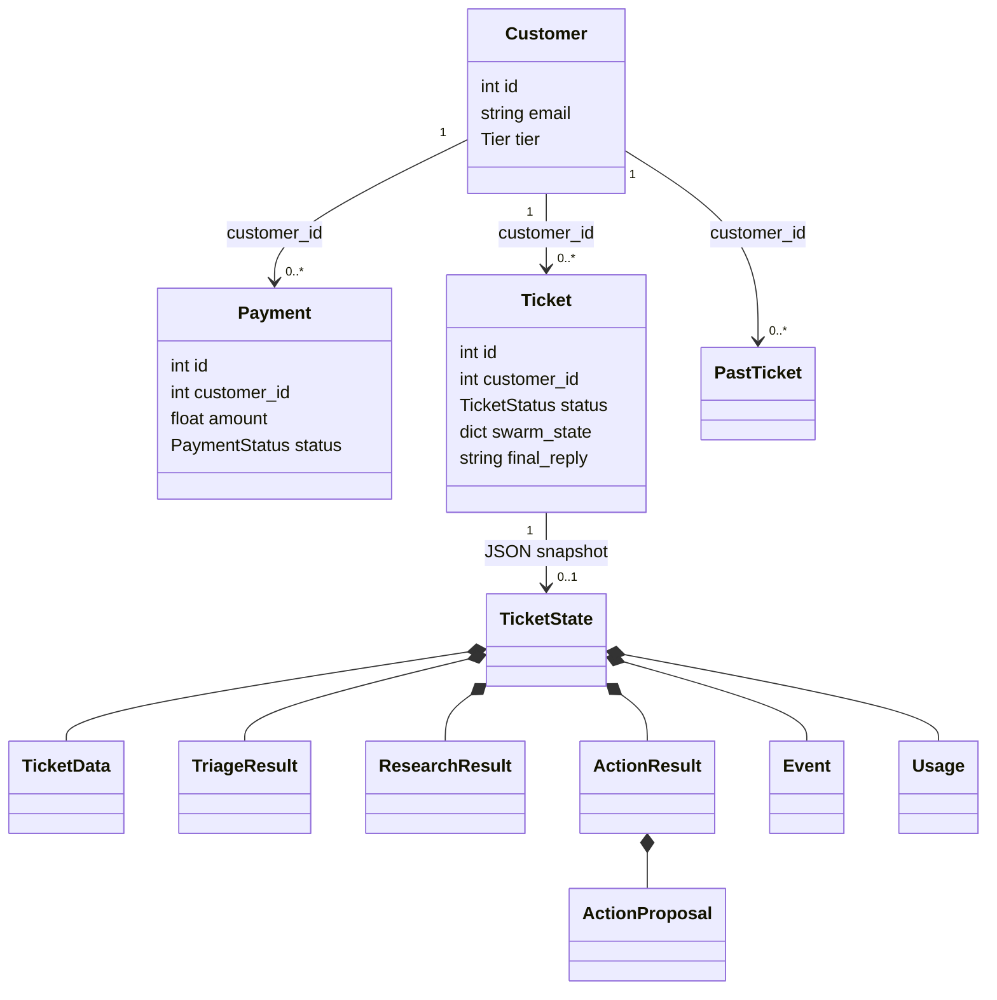

# Current progress and requirements gap

Assessment date: 30 October 2026 (IST). Evidence: static source inspection, not runtime verification.

## Selected destination

The user selected:

- A hackathon demonstration, not a production-ready service.
- The repository README plus verified code as the requirements baseline.
- Resend email and Stripe refunds through real provider APIs.
- Stripe sandbox/test-mode payments and approved email test recipients only.
- Documentation before implementation, with clear flows and diagrams.
- Small modules, clear folders, and minimal dead or repeated code.

There is no separate product requirements document in the inspected tracked file inventory. Do not treat every current behavior as an approved requirement. Safety changes needed for real external actions are new delivery requirements.

## What exists

| Area | Static evidence | Current progress |
| --- | --- | --- |
| Ticket intake | `backend/routers/tickets.py` | Validates length, looks up a known customer, creates a ticket, starts background processing. |
| Agent pipeline | `backend/swarm/orchestrator.py` | Runs triage, research, and action in order; emits progress and errors. |
| Structured state | `backend/swarm/state.py` | Defines typed triage, research, action, event, and usage data. |
| Hard policy | `backend/swarm/policy.py` | Forces escalation for missing proposals/triage, suspicious tickets, critical urgency, angry VIPs, low confidence, and unsafe auto-refund amounts. |
| Research isolation | `backend/swarm/tools.py` | Scopes customer-record tools to the ticket customer. |
| Persistence | `backend/models.py`, `backend/db.py` | Stores customers, payments, tickets, past tickets, and help documents in SQLite. |
| Lifecycle | `backend/ticket_service.py` | Starts jobs, saves final state, records local refund changes, handles review, resets interrupted jobs. |
| Human review | `backend/routers/tickets.py`, `backend/routers/slack.py` | Web and signed Slack requests use the same review service. |
| Live updates | `backend/events.py`, ticket router, frontend hooks | In-process SSE bus, ticket history replay, and global status changes. |
| Demo setup | `backend/seed.py` | Creates fictional customers and repeatable local demo records. |
| Mission Control | `frontend/src/App.tsx`, components | Ticket inbox, ticket details, three agent cards, presets, and review controls. |
| Impact | `MetricsDashboard.tsx`, service metrics | Shows decisions, automation, escalation rules, costs, and human outcomes. |

## Requirement traceability

| ID | Requirement | Existing support | Delivery gap and acceptance condition |
| --- | --- | --- | --- |
| R01 | Demonstrate intake through a visible result | Intake, agents, SSE, outcomes exist. | Run the four presets with explicit AI/provider prerequisites. Never infer runtime success from source inspection. |
| R02 | Preserve policy and customer isolation | Python rules and scoped tools exist. | Add deterministic tests around boundaries, missing context, and invalid money values. |
| R03 | Send real test replies through Resend | No email adapter exists. `final_reply` only records text. | Store provider request identity and accepted status. Never label acceptance as inbox delivery. |
| R04 | Refund a real Stripe test payment | No Stripe adapter or provider payment mapping exists. | Select one owned payment ID; verify provider amount, currency, remaining balance, customer mapping, and test mode. |
| R05 | Prevent repeated external actions | Only in-memory running checks and local review-state checks exist. | Persist operation identity and frozen request payload. Claim actions atomically before provider calls. |
| R06 | Recover partial provider success | No provider-operation records exist. | Preserve successful refund evidence when email fails. Retry or reconcile only the incomplete operation. |
| R07 | Review safely in web and Slack | Shared `apply_human_action` exists. | Use the same fulfillment path for AI and human approval. Do not infer a refund from edited text or an unrelated amount. |
| R08 | Explain unhappy paths | Error events and generic escalation exist. | Distinguish missing configuration, policy blocks, provider rejection, pending status, and unknown outcomes. |
| R09 | Keep a clean, scalable design | Routers, swarm, integration, and hooks are separated. | Add narrow adapters and one fulfillment service. Avoid a general framework or unrelated folder rewrite. |
| R10 | Produce HLD, LLD, journey, edge diagrams | README has prose and tables, but no architecture diagrams. | Save current and proposed diagrams with labels that distinguish them. |
| R11 | Prove delivery readiness | A live-key triage script exists. | Add offline policy/service/API/provider-contract tests and separate credential-gated provider smoke checks. |
| R12 | Keep metrics truthful | Metrics use ticket state, decisions, and local resolutions. | Count confirmed refund success separately from proposals. Show model spend as an estimate. |

## Highest-impact gaps

### External actions are local placeholders

`_process` appends a reply-sent event and marks a ticket resolved without an email-provider call. `_reconcile_refund` marks the first successful payment with a similar amount as refunded. This behavior cannot support the selected real-provider target.

The README admits that no email is sent. The UI and event messages nevertheless use sent/refunded language. Provider integration must replace those claims, not merely add API calls beside them.

### Model failure silently activates simulation

`backend/swarm/triage.py`, `research.py`, and `action.py` use heuristic or simulated results when credentials are absent or API calls fail. Some simulated results carry high confidence and can pass the current policy. The README statement that AI agents do not work without keys does not describe this behavior.

Record model-versus-simulation provenance. A simulated or failed agent run must not authorize automatic real provider effects. Fail closed or require explicit review of a safe reply. Never hide an unavailable model behind a successful-looking provider demonstration.

### Money actions lack exact identity

`Payment.amount` uses a floating-point number. `Payment` has no currency, Stripe customer ID, or Stripe payment ID. `ActionProposal` selects a refund amount, not a payment ID. Equal amounts do not identify one payment.

Use integer minor units for provider operations. Restrict the initial provider path to USD. Verify a single exact payment, ownership, currency, test mode, successful charge state, and refundable balance. Never infer external payment identity from a seeded record.

### Review and rerun need durable protection

Web review performs a status read before the service performs another read. The service then commits without a conditional database claim. Multiple reviewers can pass the same check. Slack signatures verify Slack origin, not permission for every Slack user to issue a refund.

`start_processing` clears the previous decision and reply. A real provider operation must survive reruns and restarts. Rerunning a resolved ticket must not issue another refund or erase its action record.

### Failure and delivery status are different concepts

An agent failure produces an error event and later escalation. Escalation does not guarantee a valid draft exists. Approval must reject a missing or blank reply.

A Stripe refund can be pending or fail later. Resend acceptance does not prove mailbox delivery. An interrupted request can leave the provider result unknown. Unknown results require reconciliation, not an immediate new action.

### Refund eligibility and privacy need explicit boundaries

The hard refund policy checks an amount and confidence, but not all refund conditions in the seeded help documents. Those documents make monthly charges non-refundable, limit annual/add-on requests to 14 days, and route enterprise refunds separately. Provider-backed fixtures need explicit eligibility evidence. Missing evidence must block automation.

Triage masks selected card and phone patterns, but research and action use the original ticket. Apply the same selected-pattern sanitization at every model boundary. Do not claim that this removes all personal data.

Research tools deny unrelated customer IDs only when a trusted customer scope exists. A missing scope currently permits lookup. Fail closed for missing scope. Customer-scoped tools and CORS do not authenticate app users.

The app exposes ticket data and mutation routes without authentication. Protect demo access and restrict Slack reviewers before public exposure of provider-backed actions. Full production identity and tenancy remain outside the hackathon target.

Normal reseeding merges mutable tickets and payments. It can restore a refunded local payment to succeeded or reopen a seeded ticket. Keep provider bindings and operation records outside seed overwrite paths. Refuse destructive reset or unsafe reseeding when provider operations exist.

### Scale is intentionally limited

The event bus, `_live` state, and running tasks exist in one process. Queues have no size bound. Startup recovery resets processing tickets to open. SQLite connections use a SQLite-only option even when `DATABASE_URL` changes.

Keep one process for the hackathon. Do not claim horizontal scaling. Document PostgreSQL, durable jobs, shared event delivery, and authentication as later production work.

## README corrections needed

- Add the existing `POST /tickets/{id}/review` and `GET /events/stream` endpoints.
- Explain web review as an alternative to Slack.
- Clarify customer IDs versus ticket IDs. The seed assigns Marcus customer 2 and ticket 1; Eleanor customer 1 and ticket 2. The existing Slack ticket-1 example is correct.
- Explain `pending` and `closed` only if the implementation uses those statuses. The enum alone does not establish a lifecycle.
- Replace local-only send/refund claims after real provider operations exist.
- Keep seeded examples distinct from provider-backed test fixtures.
- Document a permitted Resend sender, approved recipient mapping, Stripe sandbox setup, and non-secret payment mappings.
- Treat configured model IDs and pricing as unverified until account access and provider responses confirm them. Do not silently invent replacement models.

## Current domain LLD: actual model classes

These relationships come from foreign keys and typed state fields. SQLModel does not declare ORM relationship properties for them.

The target LLD in the architecture plan separates functional service modules, provider interfaces, concrete adapters, and persistent operation classes.

## Verification boundary

This assessment does not claim that dependency installation, frontend compilation, model calls, Slack interaction, or provider APIs passed. The approval plan defines those checks and their blocked outcomes. A missing credential blocks a provider smoke check but does not prevent offline implementation or deterministic tests.
