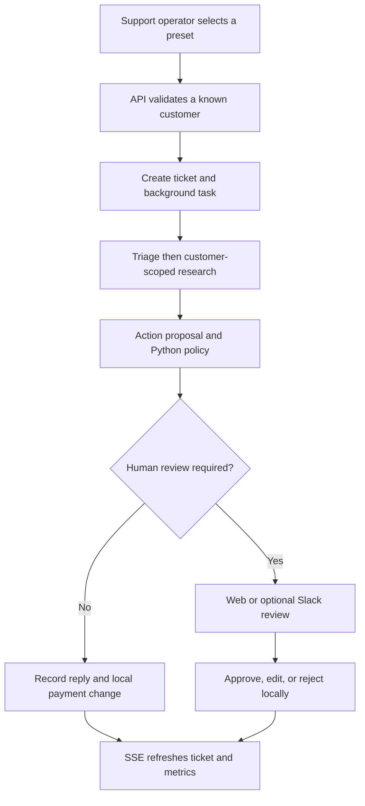
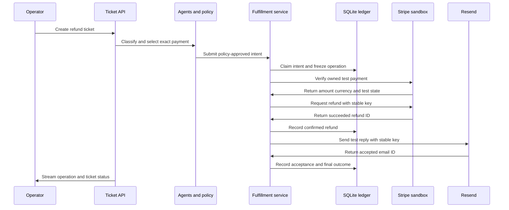
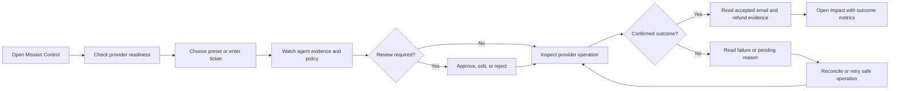
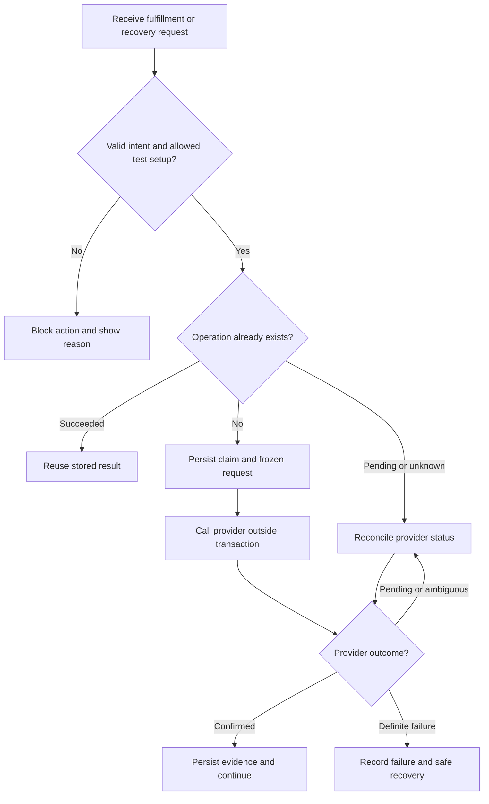

# Happy paths, user journey, and edge cases

All target flows below are proposed. Current behavior comes from static source inspection. No external action was executed during this assessment.

## Current happy flow

Current send/refund events describe local records, not real delivery or money movement.

## Target happy flow: answer without a refund

1. The operator creates a ticket for a known demo customer.
2. The API validates input and starts the agent pipeline.
3. The policy permits the answer or a reviewer approves a valid draft.
4. The fulfillment service freezes the reply and approved test-recipient mapping.
5. The database records one email operation before the network call.
6. Resend accepts the request with a stable idempotency key.
7. The database records the Resend ID and acceptance status.
8. The UI shows email accepted, not delivered.

A resolved support decision does not prove email delivery. Keep delivery-operation status visible beside ticket status.

## Target happy flow: Stripe test refund and reply

If Stripe returns pending, the flow stops before a refund-success reply. If Resend fails after a confirmed refund, recovery handles only email. Rejecting a proposal creates no refund or email operation.

## Proposed user journey

This diagram describes the support operator's journey. The fictional customer is not an authenticated app user.

The UI retains the current inbox, agent cards, presets, and Impact tab. It adds accurate provider-operation evidence and visible action errors.

## Preset acceptance paths

| Scenario | Policy destination | Target external behavior |
| --- | --- | --- |
| Password reset | Auto-resolve when confidence and policy permit. | Send the approved test recipient an answer through Resend. |
| $30 refund | Auto-refund only with one eligible exact payment and policy approval. | Refund an explicitly linked Stripe USD test payment, then send a test reply. |
| Angry VIP | Escalate through the existing VIP rule. | A reviewer approves or edits a safe reply. Refund approval remains a separate explicit intent. |
| Prompt injection | Flag suspicious and escalate. | Do not expose unrelated customer data or execute ticket instructions. Require safe review. |

Model output is not deterministic. Offline tests use controlled agent outputs. Live demonstration results depend on real model responses and account access.

## Proposed edge-case flow

A pending operation must not trigger unbounded polling. Limit each reconciliation attempt. A stale unknown email operation must not bypass Resend's idempotency retention window.

## Edge-case handling matrix

| Case | Current handling | Required target behavior and verification |
| --- | --- | --- |
| Unknown customer | API returns 404. | Preserve response. Create no ticket or provider operation. |
| Empty or whitespace input | Length validation exists; whitespace can pass. | Strip required text and reject blank values. Validate edited replies in both channels. |
| Both customer ID and email conflict | ID takes precedence. | Reject conflicting identity rather than silently choosing. |
| Duplicate process requests | `_live` rejects a running ticket. | Preserve process guard. Protect persisted action identity across reruns. |
| Two reviewers approve | Read/commit protection is not atomic. | Use a conditional database claim. One winner creates operations. |
| Reviewer edits an escalated holding reply | Review records text and uses action refund amount if present. | An edited reply alone grants no refund authority. Validate explicit refund intent independently. |
| Approved ticket has no action draft | Service can resolve with a missing draft. | Reject approve. Permit a valid edited reply only under the defined review contract. |
| Several payments have the same amount | First matching successful local payment wins. | Require an exact payment ID. Block ambiguous or foreign-customer mapping. |
| Missing currency or provider identity | Payment model lacks these fields. | Block external refund. Do not attach Stripe IDs during seed inference. |
| Negative, non-finite, zero, or excess amount | Partial validation and float comparisons. | Require finite positive integer cents and USD, within provider remaining balance and policy limit. |
| Already refunded payment | Local status reduces later matches. | Reconcile exact provider refund records. Do not create another operation for the same full refund. |
| Live Stripe key or payment | No provider path exists. | Reject live credentials and provider objects with live mode. |
| Fictional seed recipient | No email exists. | Block direct delivery. Use an explicit approved test-recipient mapping. |
| Missing provider configuration | No provider readiness exists. | Show blocked readiness and no success claim. Keep offline tests available. |
| Missing model key or API exception | Heuristic/simulated results can carry high confidence. | Record provenance and block automatic provider effects from simulation. |
| Model refusal or missing result | Some paths return conservative results or stop later steps. | Preserve error evidence. Require a valid draft before approval. |
| Monthly charge or expired eligibility | Help-doc conditions are not all hard rules. | Require explicit eligibility metadata. Escalate missing, non-refundable, stale, or enterprise cases. |
| Missing research customer scope | Tool guard permits any ID when scope is absent. | Fail closed. Do not fetch another customer's records. |
| Sensitive text reaches research/action | Selected-pattern masking occurs only in triage. | Sanitize the same selected patterns at every model boundary. Do not claim complete PII removal. |
| Reseeding after provider execution | Seed merge overwrites local operational fields. | Protect operation history and bindings. Refuse unsafe reset or overwrite. |
| Unauthenticated app or unauthorized Slack actor | Web routes trust caller identity; Slack signature proves origin only. | Require protected demo access and allowed reviewers before provider-backed public exposure. |
| Stripe pending or requires action | Not modeled. | Store the status. Do not mark payment refunded or send a success reply. |
| Stripe failure after initial response | Not modeled. | Reconcile status. Record later failure without deleting original evidence. |
| Provider timeout after possible acceptance | Not modeled. | Mark unknown. Reconcile or retry the same frozen request within provider guarantees. |
| Refund succeeds but email fails | Not modeled. | Preserve refund success. Recover email only. |
| Resend idempotency expires | Not modeled. | After 24 hours, do not blindly resend an unknown request. Require evidence or manual handling. |
| Slack notification fails | Ticket remains escalated; event records error. | Preserve web review fallback. Notification failure must not undo payment or delivery evidence. |
| Slack retry or stale modal | Already-handled check exists; malformed values can fail. | Validate payload. Acknowledge quickly. Reuse the same durable review claim. |
| Server restarts during an action | Processing tickets reset to open; tasks disappear. | Preserve operation ledger. Reconcile in-flight operations before a new action. |
| SSE reconnect during a rerun | Event IDs are indexes that restart. | Prevent unsafe reruns or use run-scoped IDs with a documented reset contract. |
| Global SSE disconnect misses changes | Browser reconnect has no full refresh trigger. | Refresh authoritative ticket and metric snapshots after reconnect. |
| Slow stream subscriber | Queue grows without a bound. | Bound queues and define reconnect/resnapshot behavior. |
| Frontend run request fails | Promise has no visible catch. | Show an actionable error. Keep controls consistent with server permissions. |
| No credentials during verification | No deterministic full suite exists. | Pass offline tests separately. Mark provider smoke checks blocked, never passed. |

## Verification scenarios

Offline verification covers policy thresholds, ownership, money conversion, operation claims, duplicate reviews, frozen payloads, partial success, pending results, and recovery after restart. API checks cover invalid input, missing tickets, and review conflicts. UI checks cover clear acceptance/pending/failure labels and visible errors.

Credential-gated smoke verification creates a controlled Stripe test payment, binds its verified identity explicitly, runs a refund, and checks the provider refund record. Resend smoke verification uses an approved test recipient and checks provider acceptance. Neither check can prove production readiness.
